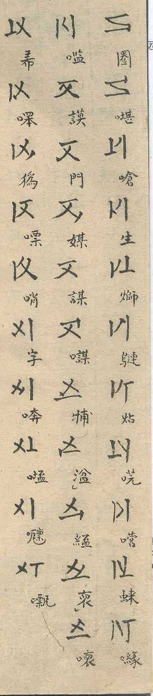

## Transcription

枝字一百一十字 (see E29)

## Notes

The evidence is the table of the Chi (E29). It lists the forms in blocks of five per Cán, 22 blocks of five, 109 forms shown. Within a block the forms differ by the position of the marking stroke; the marking stroke sits only at stroke ends, which gives six positions, one of them the position of the marked Cán (E01), so five are left for the Chi.

The table shows 109 forms, but its heading names 110 (枝字一百一十字). The missing form is an error of the author, not a feature of the system: 22 × 5 = 110, and the blocks of five follow the same pattern throughout (E29).

The rule in the claim can be read directly on the images: the marking stroke runs counter-clockwise from one form to the next within a block (stated by the proposer). A recorded check of all 22 blocks against the rule is not part of this entry.

The images show p. 3 and the part of p. 4 with the end of the table (Source 1); the rest of p. 4 is the section on the tones (E14).
