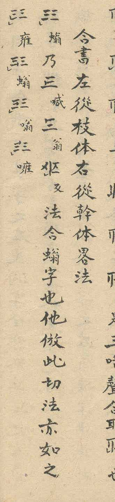

## Transcription

合書左從枝体右從幹体 (the beginning of the heading, see E07 for the whole section)

## Notes

The source calls the form without the marking stroke Cán, like the marked Cán: 幹体 in the heading of the section on the Hợp Thư (E07), 單幹書 and 幹体 in the count section (E36). The proposal calls it the unmarked Cán to tell it from the marked Cán, the forms of the listing under 幹音 (E01), which have no special name either.

The unmarked Cán appears in the combined characters of the section on the Hợp Thư (E07) and of the phản thiết pair on p. 7 (E39), and standalone with the eight tone marks on p. 5 (E15, E34).

Which of the two forms is derived from the other is not known; the proposal does not say.
