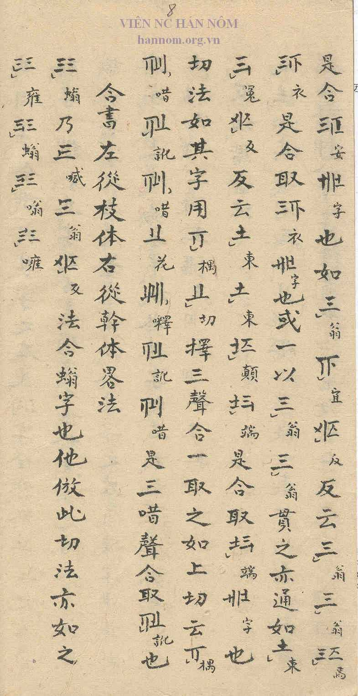

## Notes

The section on the Hợp Thư follows directly on the section 反切諧音法 (E05) and runs from p. 6, sixth column, to p. 7, second column. Reading of the heading confirmed by the proposer; transcription and translation still to be added.
