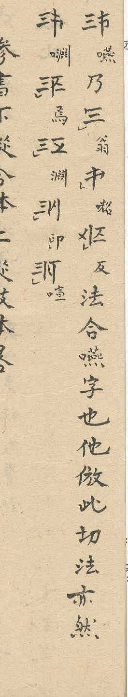

## Transcription

合書左從枝体右從幹体畧法

{QT 螉}乃{QT 喊}{CM 翁}{PT 反}法合螉字也他倣此切法亦如之

{QT 癰}
{QT 螉}
{QT 嗡}
{QT ⿰口癰}

{QT 嚥}乃{CM 翁}{QT ⿰口昭}{PT 反}法合嚥字也他倣此切法亦然

{QT ⿰口淵}
{QT 馬}
{QT 淵}
{QT 卬}
{QT 喧}

## Translation

Heading: Method of the Hợp Thư (合書), abbreviated [or: brief method]: the left follows the Chi body (枝体), the right follows the Cán body (幹体). [畧 not established, see E03]

First example (p. 6, seventh column): {QT 螉} is {QT 喊} {CM 翁} {PT 反}: by the method [they are] combined into the character 螉. The others follow this; the fanqie method is likewise.

Four further characters follow, each with a Nôm annotation (p. 6, eighth column).

Second example (p. 7, first column): {QT 嚥} is {CM 翁} {QT ⿰口昭} {PT 反}: by the method [they are] combined into the character 嚥. The others follow this; the fanqie method is likewise.

Five further characters follow, each with a Nôm annotation (p. 7, second column).

[Draft translation, to be checked. The placeholders stand for QATT characters, the character after the class is the small Nôm annotation beside it. The role of 乃 and of the QATT character annotated 反 in the formula is not established.]

## Notes

Transcribed by Claude from the images of both sources (Source 2 is clearer and was read first, Source 1 compared); the readings of the small annotations are not all certain, see Open. Notation as in the [evidence README](README.md); `{QT …}` is a QATT character whose class (marked or unmarked Cán, Chi, pair) has not been determined, `{CM 翁}` the marked Cán, identified by the proposer (E34).

### Findings

- The section on the Hợp Thư runs from p. 6, sixth column from the right (heading), to p. 7, second column. It consists of two worked examples in running text (p. 6, seventh column; p. 7, first column) and two lists of characters with Nôm annotations and no text (p. 6, eighth column, four characters; p. 7, second column, five characters).
- Both worked examples have the same form: a QATT character with its annotation, 乃, two or three further QATT characters, the character annotated 反, 法合, the annotation of the first character written out as a Nôm character, 字也, and the closing formula 他倣此切法亦如之 (p. 6) or 他倣此切法亦然 (p. 7).
- The two occurrences of the marked Cán outside the listing of the 22 Cán are in these worked examples (E34): p. 6, seventh column, fourth character, and p. 7, first column, third character. The second carries a tone mark.
- The Nôm character that closes each formula (螉, 嚥) is the same as the annotation beside the first QATT character of the formula.

### Open

- Annotations that are not certain: 癰 and ⿰口癰 (p. 6, eighth column, first and fourth), 嚥 (p. 7, first column), ⿰口昭 (p. 7, first column, third), ⿰口淵 (p. 7, second column, first) and 卬 (p. 7, second column, fourth); 螉 is 虫 with 翁 and is read ong ('bee') in Vietnamese. To be checked against the originals.
- The proposer reads the formulas as follows (not yet checked against the originals): in a formula the Cán is written in its marked form, the form of the listing, as the name of the base; in the combined character explained by the formula it stands, without marking stroke, as the unmarked Cán. The columns that follow each example show the same character with the marking position of the Chi, on the left, run through the positions, while the Cán, on the right, has no marking stroke. This would make the examples Hợp Thư with the Chi on the left and the Cán on the right, as the heading says; and the marked Cán in the formula a name for the unmarked Cán of the combined character. Open: the composition of the combined character of the second example (p. 7, first column), whose two parts seem to belong to different bases.
- Class and tone marks of the QATT characters are not transcribed, except for the two occurrences of the marked Cán.
- The proposer observes that the second worked example (p. 7, first column) does not have the structure named in the heading, the Chi on the left and the Cán on the right; the page reads as a continuation of the section. The count section (E36) names two arrangements under 合書, 左從枝体右從幹体 (880) and 左從幹体右從枝体 (18,480). To be examined which of the two the second example shows.
- Whether the examples show that in a Hợp Thư the Chi gives the initial and the Cán the rhyme (E08) is not concluded here; the readings of the annotations would have to be examined.
- Whether 畧 in the heading is part of a term (E03).
