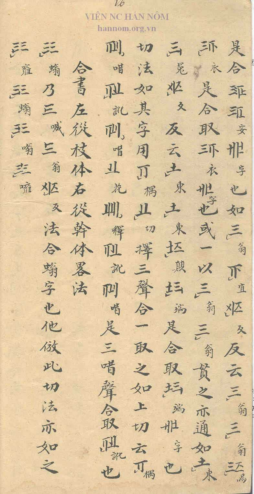
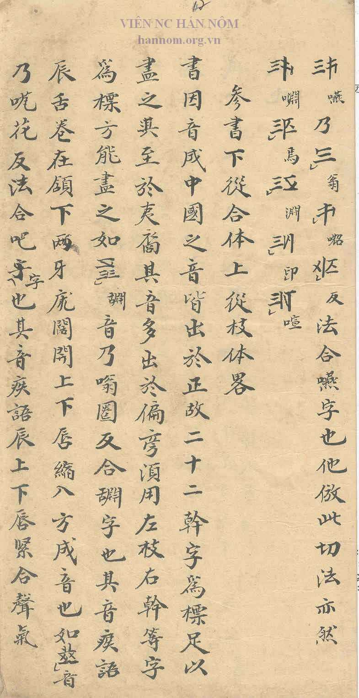

## Notes

The section on the Hợp Thư follows directly on the section 反切諧音法 (E05) and runs from p. 6, sixth column, to p. 7, second column. Reading of the heading to be confirmed; transcription and translation still to be added.
