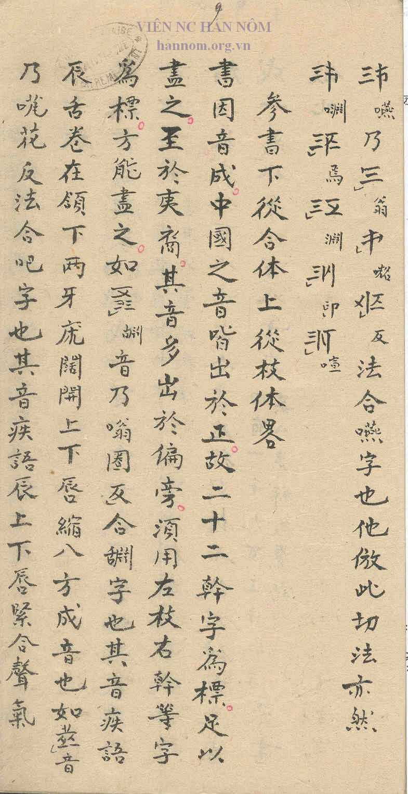
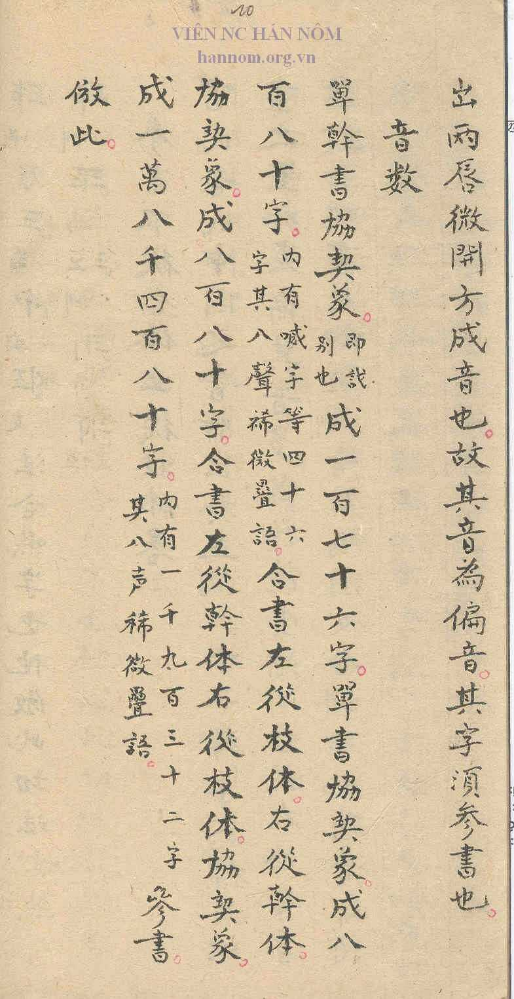

## Notes

The section on the Tham Thư runs from its heading in the third column of p. [7](pages/S1-p7.jpg), after the section on the Hợp Thư ([E07](E07.md), [E08](E08.md)) and the passage without heading on p. [7](pages/S1-p7.jpg) ([E39](E39.md)), to the first column of p. [8](pages/S1-p8.jpg). Reading of the heading confirmed by the proposer. It is followed only by a final section with counts of the character combinations. Transcription and translation still to be added.
