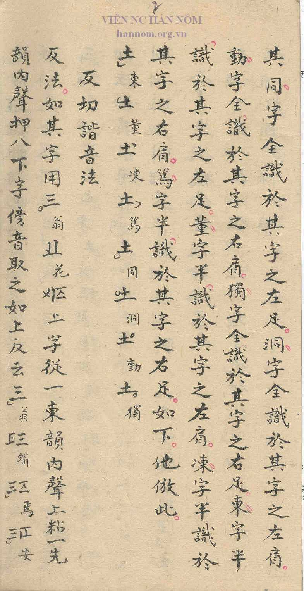

## Transcription

本字八音識別法。於本字上依陰陽四象識別，每一字各成八字。如同東合一字，惟同音其聲在上為陽，東音其聲在下為陰。以陰陽分配，則東董凍篤四音是陰之平上去入，同洞動獨四音是陽之平上去入。以四象識別，則陽用全圈，陰用半圈。

其同字全識於其字之左足，洞字全識於其字之左肩，動字全識於其字之右肩，獨字全識於其字之右足；東字半識於其字之左足，董字半識於其字之左肩，凍字半識於其字之右肩，篤字半識於其字之右足。如下。他倣此。

{CU 東}{CU 董}{CU 凍}{CU 篤}{CU 同}{CU 洞}{CU 動}{CU 獨}

## Translation

Method of distinguishing the eight tones of a character: on the character, distinguish by yin and yang and the four images (四象), so that each character forms eight characters. For example, 同 and 東 are combined in one character; but the sound of 同 is above and is yang, the sound of 東 is below and is yin. Divided by yin and yang, the four sounds 東 董 凍 篤 are the level, rising, departing and entering tones of yin, and the four sounds 同 洞 動 獨 are the level, rising, departing and entering tones of yang. Distinguished by the four images, yang uses a full circle and yin a half circle.

For 同 the full circle is marked at the left foot (lower left) of the character, for 洞 at the left shoulder (upper left), for 動 at the right shoulder (upper right), for 獨 at the right foot (lower right); for 東 the half circle at the left foot, for 董 at the left shoulder, for 凍 at the right shoulder, for 篤 at the right foot. As below; the others follow this pattern. [Draft translation, to be checked]

## Notes

Same passage as E14.
