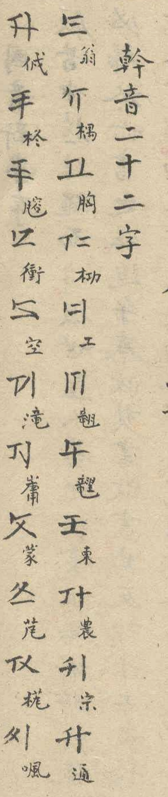

## Transcription

幹音二十二字 · Nôm annotations in order (IDS where no encoded character is used): 翁 ông · ⿰木禺 ngông · 胸 hông · ⿰木功 gông · 工 công · ⿰竜羽 lông · ⿰竜里 trông · 東 đông · 農 nông · 宗 tông · 通 thông · ⿰亻戍 nhông · 柊 chông · ⿰月容 dông · 衝 xông · 空 không · 滝 sông · ⿱山庸 rông · 蒙 mông · 芃 bông · ⿰木芃 vông · ⿰口風 phông

## Translation

Heading: 'trunk sounds, twenty-two characters' (幹音, cán âm)

## Notes

Nôm annotations verified by the proposer. Also shows the count of 22 (E01).
