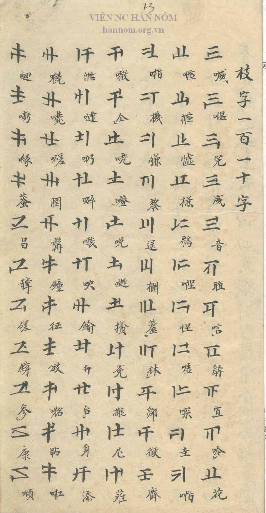
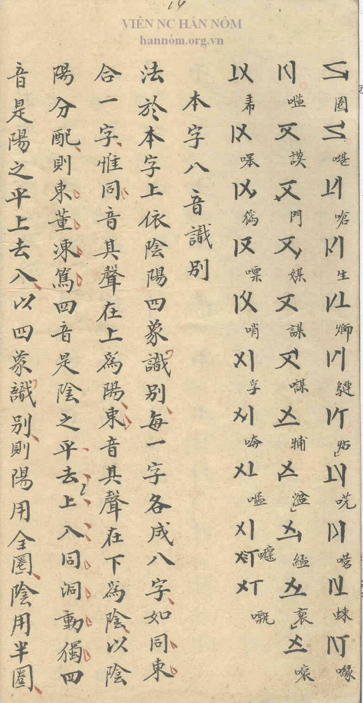
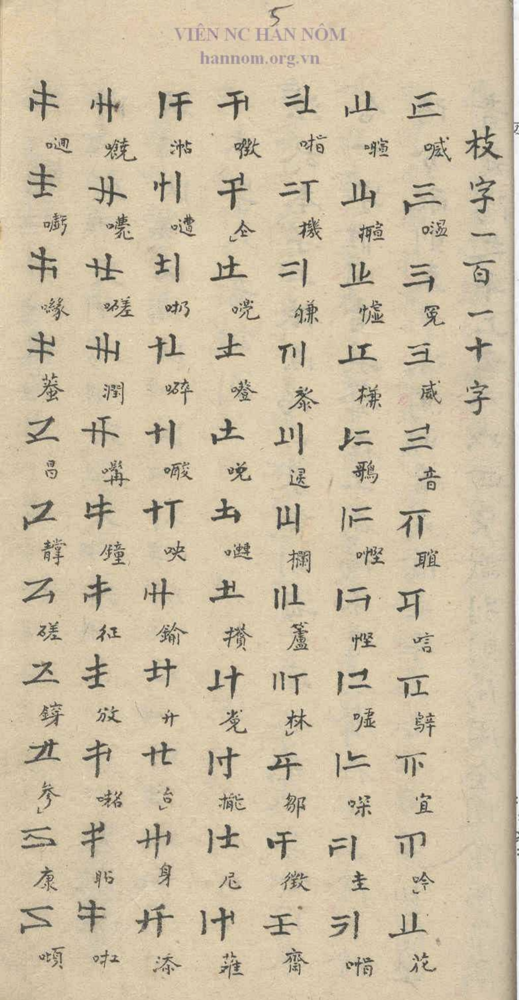
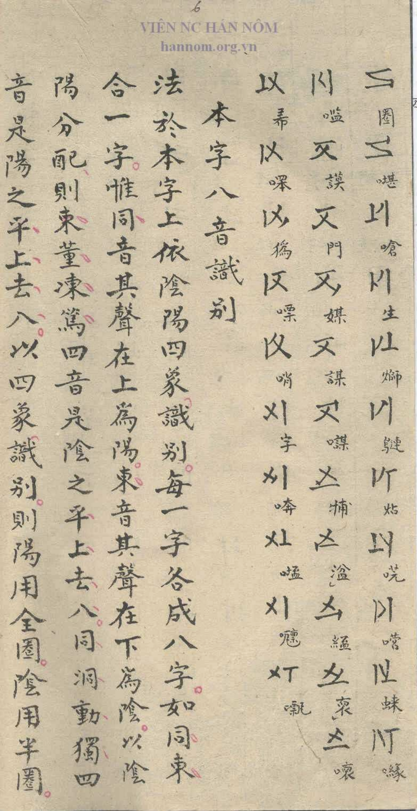

## Transcription

枝字一百一十字 · 109 Chi Tự, each annotated with a Nôm character

## Translation

Heading: 'the 110 Chi Tự' (literally 'branch characters, one hundred and ten characters')

## Notes

### Findings

- The author gives the number 110 in the heading.
- The table lists 109 Chi Tự: 77 on p. 5 (7 columns of 11), 32 on p. 6 (11, 11, 10). The systematic arrangement in blocks of five per Cán Tự shows that one was left out by oversight.

### Open

- Which Chi Tự is missing.
- Whether Source 2 also lists 109: the end of its last column differs from Source 1 near the entries annotated 嘘 and 嘰.
- Page numbering: the handwritten numbers read 5 and 6 in Source 1 but 13 and 14 in Source 2.
- Transcription of the 109 Nôm annotations.
