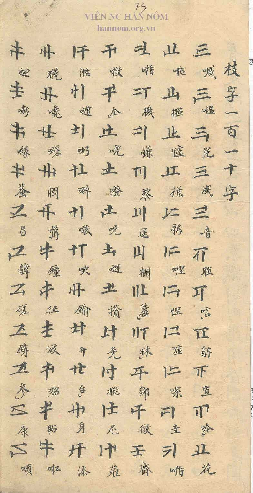
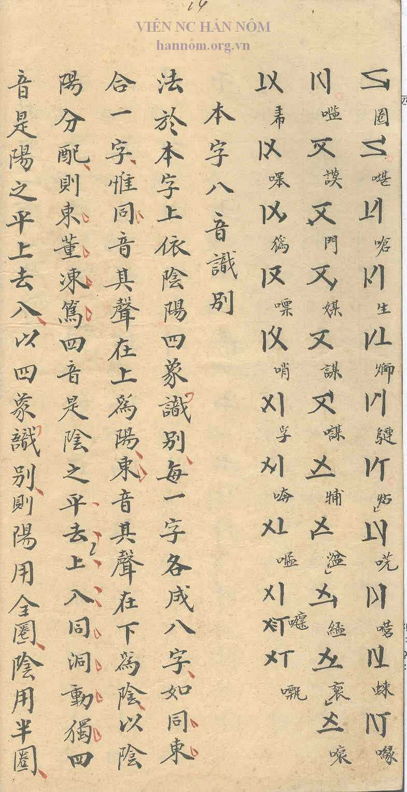
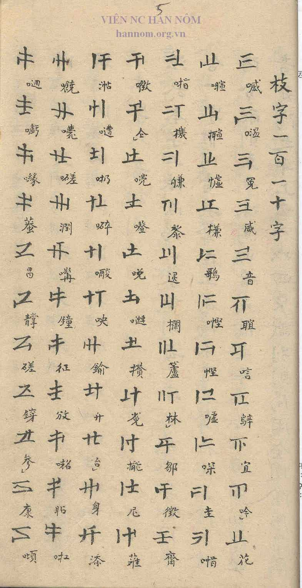
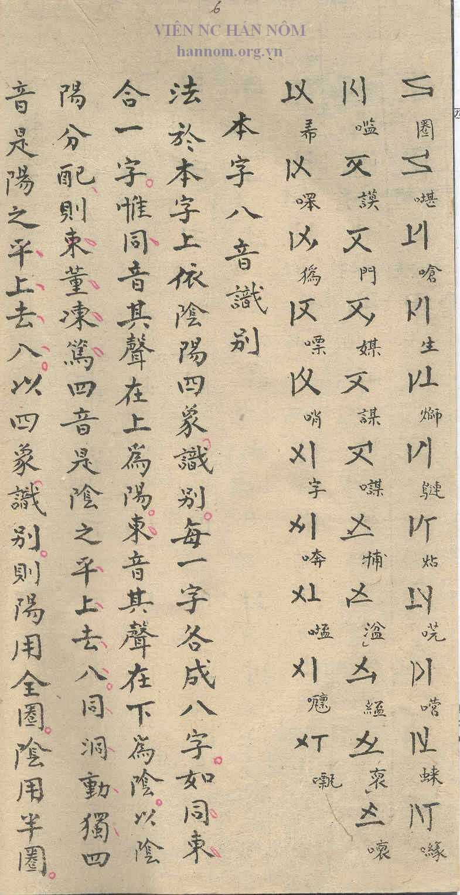

## Transcription

枝字一百一十字 · 109 Chi Tự, each annotated with a Nôm character

## Translation

Heading: 'the 110 Chi Tự' (literally 'branch characters, one hundred and ten characters')

## Notes

### Findings

- The author gives the number 110 in the heading.
- The table lists 109 Chi Tự: 77 on p. 3 (7 columns of 11), 32 on p. 4 (11, 11, 10). The systematic arrangement in blocks of five per Cán Tự shows that one was left out by oversight.
- Source 2 also lists 109. Its third entry from the end of the list is struck out with three dots and written again (C03).

### Open

- Which Chi Tự is missing.
- Transcription of the 109 Nôm annotations.
