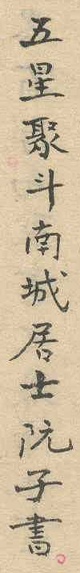

## Transcription

五星聚斗南城居士阮子書

## Translation

When the five planets gathered in Đẩu (斗), written by Nam Thành cư sĩ Nguyễn Tử. [Draft translation, to be checked]

## Notes

Confirmed by the proposer; identification of Nam Thành with Nam Định is speculative and not used. The phrase 五星聚斗 is not interpreted here; whether it records a date is open.
