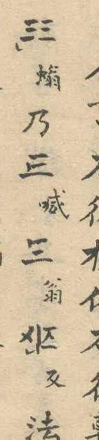
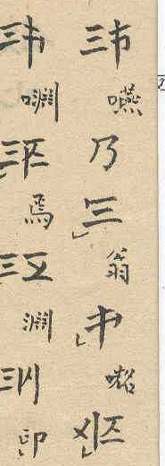

## Notes

Stated by the proposer from the whole text; the listing of the Cán ([E18](E18.md)) shows the marked form, the tone examples ([E15](E15.md)) the unmarked form standing alone.

### Findings

- Outside the listing of the 22 Cán (p. 2, [E18](E18.md)) the marked Cán occurs only twice, as a separate character with a reading, not as an abstract entry of a list (stated by the proposer): p. 6, second column from the left, 4th character (no tone mark), and p. 7, first column from the right, 3rd character (with a tone mark, the semicircle at the lower left). Both are the Cán of ông, annotated 翁 in small characters. The top stroke ends in a short downward stroke at the left, the marking stroke. The images show columns 7 of p. 6 and 1 of p. 7 (Source 1).
- The unmarked Cán is shown standing alone for đông with the eight tones (p. 5, [E15](E15.md); also p. 6, [E04](E04.md)) and in the combined characters of the examples for ONG ([E07](E07.md), [E39](E39.md)). There is no listing of the unmarked forms. That all 22 Cán occur as unmarked Cán in combinations follows from the counts in the section 音数 (p. 8, [E36](E36.md)): 880 = 110 × 8 pairs of the same base and 2,310 × 8 pairs of different bases; this is an inference, not a statement of the source.
- The source calls the form without the marking stroke Cán, like the marked Cán: 幹体 in the heading of the section on the Hợp Thư ([E07](E07.md)), 單幹書 and 幹体 in the count section ([E36](E36.md)). The proposal calls it the unmarked Cán to tell it from the marked Cán, whose forms have no special name either.
- The first place lies in the section on the Hợp Thư ([E07](E07.md)), the second in the passage without heading on p. 7 ([E39](E39.md)) before the section on the Tham Thư ([E10](E10.md)).
- The marked Cán does not combine in either place.
- Proposer's reading: in both places the marked Cán is written in a formula as the name of the base, and stands, without marking stroke, as the unmarked Cán in the combined character explained by the formula ([E07](E07.md), [E39](E39.md)).

### Open

- Function of the two occurrences in the passage; transcription of the surrounding text.
- Proposer's hypothesis, not yet researched: the marking could identify the head word, which would explain why the listing of the 22 Cán shows the marked form. Not used in the proposal.
