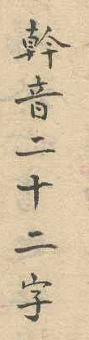

## Transcription

幹音二十二字

## Translation

Trunk sounds, twenty-two characters. [Draft translation, to be checked]

## Notes

The heading names the listing by its sounds (音); 字 counts the characters. Location given by the proposer. The listing itself is E18. The heading names the base forms 幹, Cán; the term Cán Tự is not used in the proposal. Proposer's hypothesis, not yet checked and not used in the proposal: 幹音 names the base as a sound (the listing gives each Cán with the name of its pronunciation), 幹字 names it as a symbol or character (the characters that serve as marks, 為標).
