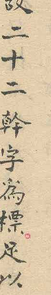

## Transcription

故二十二幹字為標足以

## Translation

Therefore the twenty-two Cán characters serve as the marks, which suffice to … [Draft translation, to be checked; the rest of the sentence is not transcribed]

## Notes

Location given by the proposer; the reading was checked on the image in both sources, which write the same characters. Together with 幹音二十二字 ([E37](E37.md), p. [2](pages/S1-p2.jpg)) the source uses 幹 with 音 and with 字, so 幹 is the term and 音 and 字 are additions (proposer's observation). The surrounding text of this column is not transcribed yet. Proposer's hypothesis, not yet checked and not used in the proposal: 幹音 names the base as a sound (the listing gives each Cán with the name of its pronunciation), 幹字 names it as a symbol or character (the characters that serve as marks, 為標).
